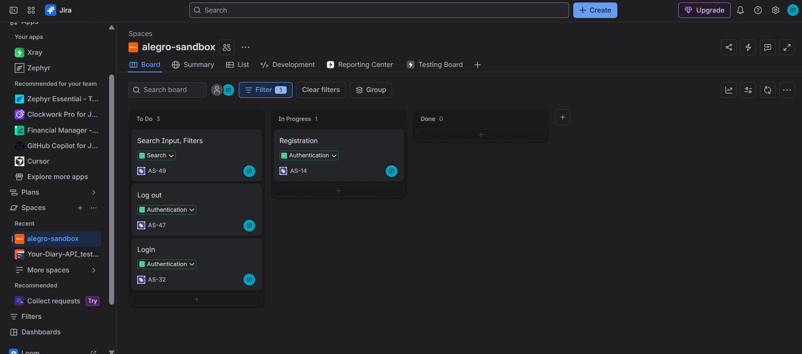
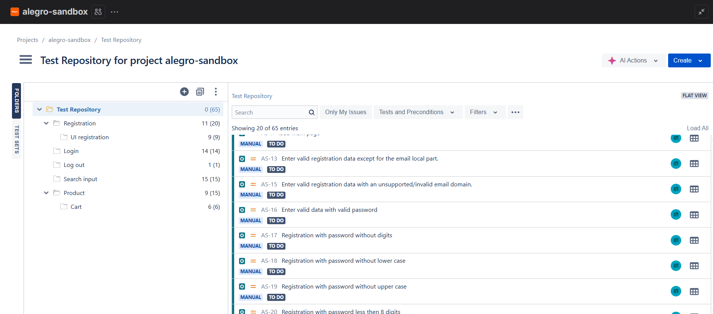
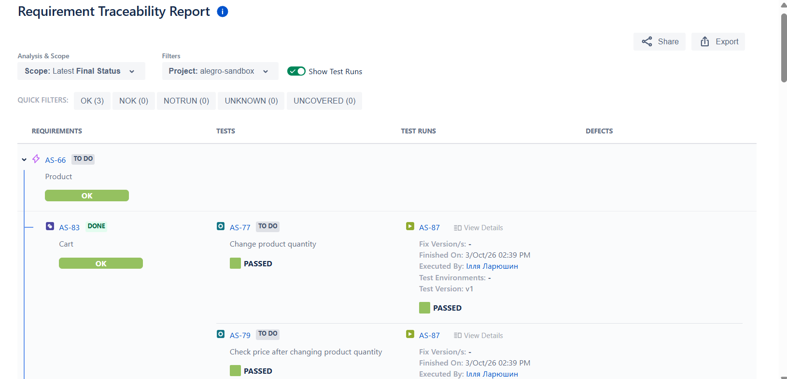
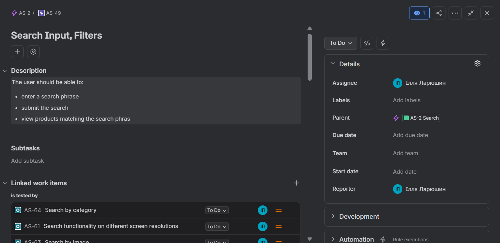
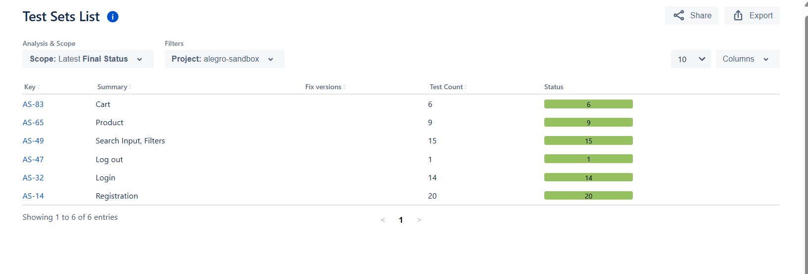

# Manual QA Portfolio Project

### Application: Allegro Sandbox

<div style="display:flex; flex-direction: row;">
  
  
  
  
  
</div>

### Testing scope:
- Registration, Login, Logout, Search, Product, Cart

### Testing types:
- Functional, UI, Positive/Negative,
- Boundary Value, Responsive, Exploratory Testing

### Tools:
- Jira, Xray, GitHub, Chrome DevTools

### Deliverables:
- Test Plan
- Test Basis
- Test Cases
- Test Sets
- Test Executions
- Traceability Matrix
- Test Report
- Bug Reports
- Exploratory testing
## 📁 Project Structure

```text
allegro-sandbox/
├── 01_Test_Plan
├── 02_Test_Basis
│   ├── Authentication
│   ├── Search
│   ├── Product
│   ├── Cart
├── 03_Test_Cases (Jira+XRay) & pdf/csv exports
│   ├── Test Cases Report
│   ├── Test Sets Report
│   └── Traceability_Report + Execution Report
├─── Exploratory Testing Report
```
